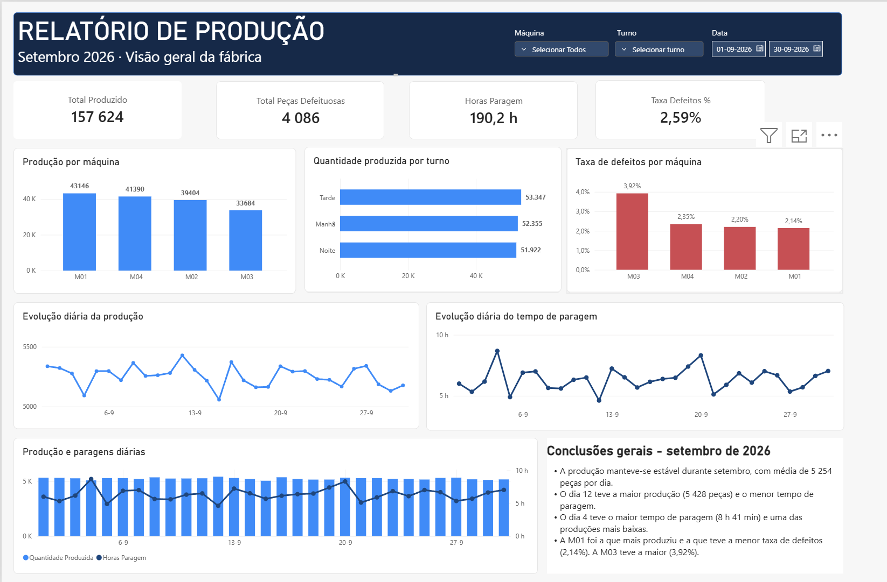

## Industrial Production Analysis

# Sobre o projeto

Este projeto tem como objetivo analisar dados de produção industrial, identificando padrões de produtividade, qualidade e tempos de paragem de máquinas.

Através de Python e Power BI, foram analisados indicadores de desempenho de uma fábrica, com o objetivo de compreender o comportamento da produção e identificar possíveis oportunidades de melhoria.

O projeto foi desenvolvido para fins de aprendizagem e construção de portefólio na área de Análise de Dados.

# Ferramentas utilizadas

- Python — processamento e análise de dados
- Pandas — tratamento, agrupamento e exploração dos dados
- Matplotlib — criação de gráficos
- Seaborn — visualização de dados
- Power BI — desenvolvimento de um dashboard interativo

# Dados utilizados

Foi utilizado um conjunto de dados de produção industrial para o mês de setembro de 2026.

**Características dos dados:**

- 360 registos
- 4 máquinas industriais
- 3 turnos de trabalho: manhã, tarde e noite
- 30 dias de produção

**Variáveis disponíveis:**

- data — data do registo
- maquina — identificação da máquina
- turno — turno de produção
- horas_planeadas — horas de trabalho previstas
- tempo_paragem_min — tempo de paragem em minutos
- quantidade_produzida — quantidade de peças produzidas
- quantidade_defeituosa — quantidade de peças com defeito

**Nota:** os dados são utilizados para fins educativos e não representam a produção real de uma empresa.

# Análises realizadas

Durante o desenvolvimento do projeto foram realizadas diferentes análises:

1. Exploração e validação dos dados

- Verificação de valores em falta
- Identificação de registos duplicados
- Validação dos tipos de dados
- Conversão e tratamento de datas

2. Análise da produção

- Produção total da fábrica
- Produção por máquina
- Produção por turno
- Identificação das máquinas com maior e menor produção
- Evolução diária da produção

3. Análise da qualidade

- Quantidade total de peças defeituosas
- Peças defeituosas por máquina
- Cálculo da taxa de defeitos
- Comparação da qualidade entre máquinas

4. Análise dos tempos de paragem

- Tempo total de paragem da fábrica
- Tempo de paragem por máquina
- Evolução diária das paragens
- Comparação entre produção e tempo de paragem

# Dashboard Power BI

Foi desenvolvido um dashboard interativo para apresentar os principais indicadores de produção industrial.

O relatório permite filtrar os resultados por máquina, turno e intervalo de datas.

**Indicadores principais:**

| Indicador | Resultado |
|---|---:|
| Produção total | 157 624 peças |
| Peças defeituosas | 4 086 |
| Tempo total de paragem | 190,2 horas |
| Taxa global de defeitos | 2,59% |

**Pré-visualização**



# Principais conclusões

**Produtividade**

A fábrica apresentou uma produção relativamente estável durante setembro, com uma média aproximada de 5 254 peças por dia.

A máquina M01 apresentou a maior produção, com 43 146 peças, enquanto a M03 registou a menor, com 33 684 peças.

**Qualidade**

A máquina M03 apresentou a maior taxa de defeitos, aproximadamente 3,92%.

A máquina M01 registou a menor taxa de defeitos, aproximadamente 2,14%.

**Tempos de paragem**

A máquina M03 apresentou o maior tempo acumulado de paragem, aproximadamente 81,3 horas.

O dia 4 registou o maior tempo total de paragem, enquanto o dia 12 apresentou a maior produção diária, com 5 428 peças.

**Interpretação**

Os resultados indicam que a máquina M03 merece uma análise mais aprofundada, devido à combinação de menor produção, maior taxa de defeitos e maior tempo de paragem.

No entanto, os dados disponíveis não permitem identificar diretamente as causas dos problemas. Para isso, seriam necessárias informações adicionais sobre manutenção, avarias, operadores e condições de funcionamento.

# Estrutura do projeto

```text
industrial-production-analysis/
│
├── data/
│   └── producao_industrial.csv
│
├── outputs/
│   └── dashboard.png
│
├── Industrial_Production_Dashboard.pbix
├── main.py
└── README.md
```
# Possíveis melhorias futuras

· Análise dos motivos das paragens das máquinas
· Inclusão de dados de manutenção e avarias
· Cálculo de indicadores adicionais de eficiência industrial
· Comparação entre diferentes períodos de produção
· Automatização da atualização dos dados no Power BI

Projeto desenvolvido para aprendizagem prática de Python, análise de dados e Business Intelligence.
